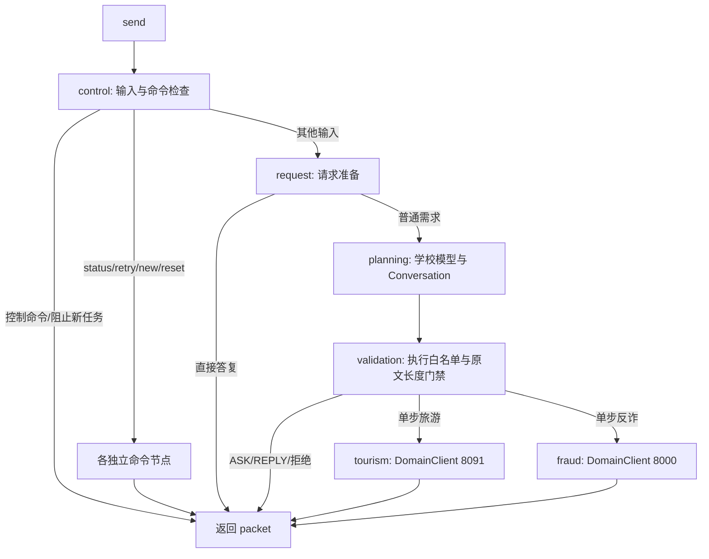

# A1 总智能体 LangGraph 迁移计划

## 目标与分工

保持 DomainChat.send(text) 入口与现有 packet，使用 LangGraph 显式状态图组织调度。
A1 负责模型规划、原文证据、校验、白名单、反诈状态与幂等重试。
8091/8000 仍由队友实现。P2 正式任务账本、A2/A3 接入不属于本次迁移完成范围。

## 实施顺序与完成情况

1. 已完成：安装 LangGraph 1.2.20，requirements.txt 固定直接依赖版本；本机 Python 3.12。
2. 已完成：新增 graph_runtime.py，StateGraph 节点 control、request、status、retry、new、reset、planning、validation、tourism、fraud。
3. 已完成：DomainChat.send 默认执行编译后的图；每轮独立图状态，会话仍由 Conversation 管理。
4. 已完成：保留固定失败 packet、地点门禁、单步白名单、pending 原键重试；增加同一会话调用锁。
5. 验收：运行全部 test_*.py，另增加图路径、控制命令短路、轮次隔离与实例隔离测试。
6. 后续联调：连接学校模型与队友服务，核对真实输入输出；单元测试不能替代端到端验收。
7. 后续 P2 对齐：确认持久化任务归属、恢复标识和去重语义后，再启用 checkpoint/interrupt 恢复。
8. 已完成：P2 v3 七类 invocation reason 使用独立 `v3_reason_graph.py` 显式路由；
   各分支业务仍由 `v3_adapter.py` 校验执行，不启用自动副作用重放。

## 当前实际流程



planning 内继续使用严格 validate_plan 与 enforce_location，validation 节点进一步决定可否委派。
模型没有工具调用权限，也不能指定 URL。图节点只调用程序固定客户端。
/status、/retry、/new、/reset 已分别路由到 status、retry、new、reset 独立节点。control 只做输入检查与路由；request 保留普通请求准备、overview 与图片命令处理。四个命令不重新规划，保持原状态机和 packet。

2026-11-05 本轮验收：A1 核心完整回归 124 项通过，A1new/test_server 入口兼容测试 8 项通过；未进行真实学校服务联调。
executionTrace 是公开执行事件，不是模型内部思维链；它与图节点名称不必一一对应。

## 验收命令

```powershell
cd "D:\desktop\26挑战杯\a1-orchestrator"
python -m pip install -r requirements.txt
python -X utf8 -m unittest discover -p "test_*.py"
python -X utf8 domain_chat.py
```

不启用自动副作用重放，不宣称进程重启后可继续当前会话。
本次不改前端样式、8095 路由或队友领域服务，也不自动启用云追踪。
